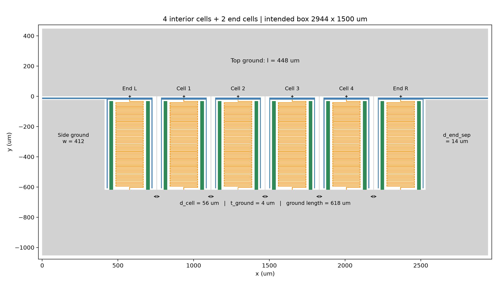
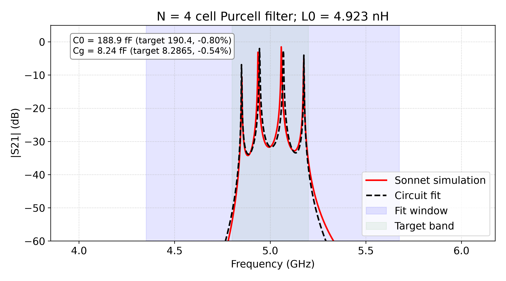
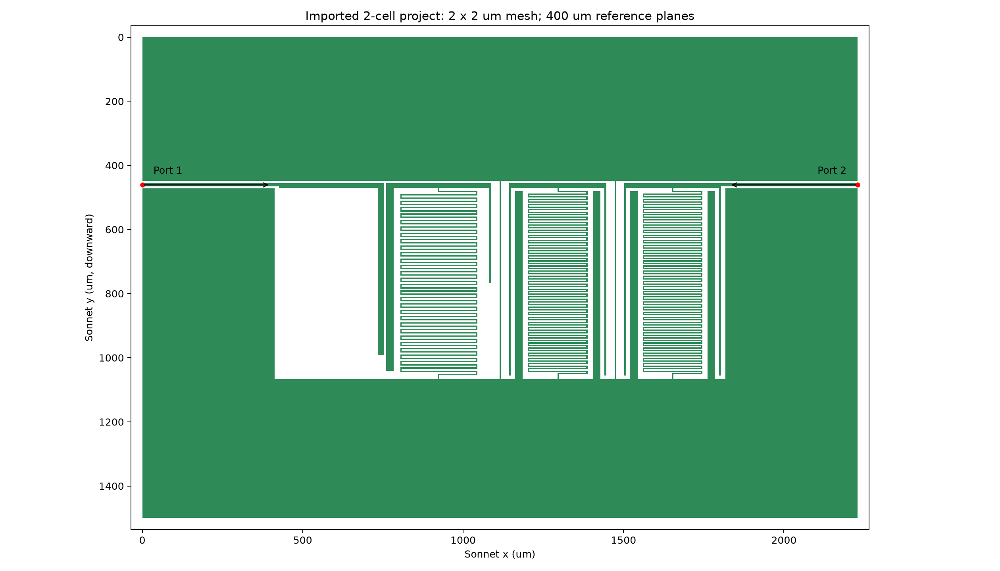
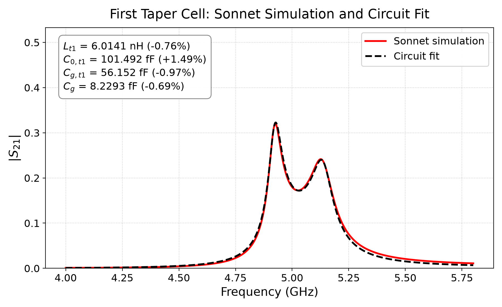

# Automating Microwave Filter Design: From Geometry to the First Taper

The aim is to turn filter design into a repeatable loop: change geometric parameters in Python, generate the layout, simulate it in Sonnet, compare the response with an equivalent circuit, and choose the next geometry. This page covers the initial automation, the regular-cell benchmark, and the selected first taper. Second-taper development is separate and remains unfinished.

## 1. What is automated?

```text
Python geometry parameters
          ↓
GDSII layout + parameter record + preview
          ↓
Sonnet GDS importer → native .sonx project
          ↓
Configure materials, mesh, ports and frequency sweep
          ↓
Sonnet EM simulation → Touchstone S-parameters
          ↓
Equivalent-circuit fit → plots and target errors
          ↓
Choose the next geometry, or retain the selected design
```

The generation, import, simulation and analysis stages run programmatically. Geometry choices during the regular-cell and first-taper searches combined parameter sweeps, measured sensitivities and inspection of each layout. This was not a single general-purpose optimizer automatically solving every geometry problem.

The project uses Windows, Sonnet 19.52, and a local Python environment managed by `uv`. Geometry is generated with `gdstk`; numerical analysis uses NumPy, SciPy and scikit-rf, with Matplotlib for plots. `gdsfactory` was not needed.

## 2. Starting with the smallest import test

The first test generated one 200 × 100 µm rectangle on layer 1, datatype 0, in a top-level cell named `TOP`. The GDS library uses micrometre coordinates and 1 nm database precision. Importing it through the Sonnet GUI confirmed that Python-generated GDSII was accepted by the installation.

We then built reusable components instead of converting annotated CAD drawings into layouts:

| Component | Purpose |
| --- | --- |
| Cap | Top bar and two side legs |
| Meander | Inductive trace with square turns |
| Pad | Grounded rectangle; referenced twice in a regular unit |
| Unit cell | Places the cap, meander and pads together |
| N-cell array | Repeats units and adds end structures, feeds and grounds |

Parameters are grouped by component. For example, `unit.cap.w` and `unit.meander.w` are separate widths. The conventions are `w` for horizontal width, `l` for vertical extent, `d` for clear separation, and `t` for in-plane feature thickness. Here, `t` does **not** mean deposited film thickness.

The unit-cell origin is centred horizontally, 8 µm above the cap. Explicit placement anchors make components reusable. `meander.n` counts horizontal runs, including the partial first and last runs; it is distinct from the array's `n_cells`.

## 3. How the layout reaches Sonnet

Python checks the GDS against its parameter record, transforms it into box coordinates, and writes a separate version snapped to the retained **2 × 2 µm** simulation grid. The original design GDS is preserved. A 1 nm GDS database resolution does not imply a 1 nm EM mesh.

Sonnet's native `gds.exe` imports that GDS using an existing project as the settings template. Layer 1/datatype 0 is explicitly mapped to the superconducting metal. The importer creates the native `.sonx` project; Python then edits its XML settings.

The preparation code identifies the actual imported feed edges at the box walls and attaches the two external ports to those edges. It also sets the output filename, frequency sweep and reference planes. A polygon XOR check verifies that the imported metal matches the transformed, snapped GDS, and Sonnet's native read check verifies that the project is readable.

The retained settings include 50 Ω port normalization and **400 µm reference planes**. Earlier source projects used 600 µm; that could extend beyond the uniform feed region. The generated side grounds are 412 µm wide, so 400 µm stays before that discontinuity. Reference-plane shifts change the reported calibration plane; they do not delete metal or remove end structures from the EM solution.

The substrate and superconducting material model are inherited from the reference setup. Its `Ls = 0.0388 pH/square` is a sheet material property, **not** a prescribed total coil inductance. Sonnet calculates the response of the geometry with that material; the circuit inductance is extracted afterward.

## 4. Establishing the regular-cell benchmark

The selected regular unit uses a 302 µm-wide cap and a 186 µm-wide meander. The meander is 596 µm long, with 72 horizontal runs, 4 µm traces and 4 µm gaps. The array uses a 56 µm cell separation and 4 µm grounded strips between cells.

For `n_cells = 4`, the physical Sonnet layout contains **four interior cells plus two feed-connected end structures**. Sonnet solves all of that metal. The reduced circuit models four interior resonators; the end structures contribute to its termination environment. Four transmission peaks do not establish that only four physical structures were simulated.



Inductance was tuned using copies of the native single-cell reference. A 186 µm meander span gave the selected calibrated L. That saved L was then held fixed during the array-spacing search.

| Regular-cell quantity | Target | Selected result | Difference |
| --- | ---: | ---: | ---: |
| L₀ | 4.9194 nH | 4.922724 nH | +0.068% |
| C₀ | 190.4 fF | 188.878116 fF | −0.799% |
| Cg | 8.2865 fF | 8.241620 fF | −0.542% |

Reducing `d_cell` from 60 to 58 to 56 µm increased fitted Cg from 7.9402 to 8.0839 to 8.2416 fF. The final spacing met the 2% coupling tolerance without repeating the inductance sweep for each spacing.



This N = 4 extraction fitted **S21 magnitude in dB**, with L fixed. Its saved RMS residual was 4.687 dB. The component values met their target tolerances, but that is not a claim that the circuit reproduced the complete spectrum within 2%. Transferring L from the native single-cell calibration into the generated array is also an explicit modelling assumption.

## 5. Measuring inductance independently

The calibration fixture adds a known **ideal capacitor**, `C_add`, from the resonator node to ground. This component exists in the Sonnet calibration project, not in the fabrication GDS.

For a parallel LC approximation:

```text
1 / (2πf_res)² ≈ L × C_add + constant
```

The code applies 20, 30, 40 and 50 fF, tracks the same resonance, and fits this line. With capacitance in farads, its slope is inductance in henries. The constant includes background capacitance and approximately constant coupling loading.

Checks reject unresolved peaks, maxima at sweep boundaries, or resonance shifts in the wrong direction. A high regression R² supports linearity; it does not establish absolute physical accuracy. Capacitor-only changes can reuse the unchanged EM geometry solution.

## 6. First taper: targets and design challenge

The first taper needed substantially lower C₀ than the regular cell while retaining two different coupling strengths:

| Quantity | First-taper target |
| --- | ---: |
| Lₜ₁ | 6.06 nH |
| C₀,ₜ₁ | 100 fF |
| Cg,ₜ₁ — input/next-taper coupling | 56.7 fF |
| Cg — taper-to-regular coupling | 8.2865 fF |

The reference taper fixture had a 26 µm step in its **upper ground boundary**. Making that boundary continuous changed the capacitive environment and raised extracted C₀ above the target. The task was to recover approximately 100 fF while retaining the flat ground and both coupling targets.

### How the C₀ problem was solved

Changing the meander alone did not solve it. A wider-gap, 58-run meander could recover the desired L after adjusting its width, but an early coupled fixture still gave C₀ around 116.8 fF.

Shortening both cap legs reduced C₀, but also reduced the strong input coupling too far. The useful combination was an **asymmetric cap** and an **independently parameterized input coupling finger**:

- Keep the left cap leg long to retain the strong-coupling electrode.
- Shorten the right leg to reduce the taper's capacitive metal extent.
- Adjust the input finger's length and thickness to recover strong coupling.
- Tune the taper-to-regular gap separately for the weak coupling.

These controls are coupled electromagnetically, so each candidate still required simulation. This was a combined geometry solution, not a universal rule that one dimension controls only one circuit parameter.

## 7. Selected first-taper geometry



| Feature | Selected dimensions |
| --- | --- |
| Cap | Width 328 µm; top thickness 14 µm |
| Left cap leg | Length 584 µm; thickness 24 µm |
| Right cap leg | Length 310 µm; thickness 6 µm |
| Meander | Width 240 µm; length 596 µm; 58 runs |
| Meander trace / gap | 4 / 6 µm; square turns |
| Input finger | Length 536 µm; thickness 20 µm |
| Input gap | 6 µm; no ground strip in this strong-coupling gap |
| Taper-to-regular gap | 56 µm; 4 µm grounded strip |

Cap-leg and input-finger lengths include the top-bar extent. The taper has no internal grounded pads. Its neighbouring regular cell retains the established geometry and pads.

The benchmark contains an input bar/finger, the first taper, a regular resonator, and a feed-connected output end structure. It validates this fixture and its interfaces; the input finger is not a complete neighbouring taper resonator.

## 8. First-taper fitting and the fixture-delay correction

Taper L was calibrated independently and held fixed at 6.014106 nH. Regular-cell L was held at its earlier calibrated value. The mixed-fixture fit varied taper C₀, regular C₀, the three coupling capacitances, and an effective total fixture delay.

The selected objective fits **both real and imaginary S21**, rather than dB magnitude. A linear-magnitude-only fit was retained as a separate cross-check.

The delay correction multiplies model transmission by:

```text
exp(−j × 2πf × τ)
```

It changes phase while leaving magnitude unchanged. This allows smooth residual fixture phase to be represented without forcing the capacitances to compensate for it. The selected total delay was approximately **4.985 ps**. It is an effective phase correction, not an independently measured physical feed length or a change to the metal layout.



| First-taper quantity | Target | Selected result | Difference |
| --- | ---: | ---: | ---: |
| Lₜ₁ | 6.06 nH | 6.014106 nH | −0.757% |
| C₀,ₜ₁ | 100 fF | 101.492048 fF | +1.492% |
| Cg,ₜ₁ — input | 56.7 fF | 56.151540 fF | −0.967% |
| Cg — to regular cell | 8.2865 fF | 8.229325 fF | −0.690% |

All four quantities met the 2% screening criterion. The selected complex-S21 RMS residual was **0.00647**, and the linear-magnitude-only cross-check also met the component tolerances. The zero-delay complex fit narrowly missed the junction-coupling tolerance, so the fitting convention matters.

The equivalent circuit remains approximate: its complex S11/S22 RMS residuals were about 0.0685/0.0763, larger than the S21 residual. These results describe this EM benchmark on the fixed mesh, not fabricated-device accuracy or a validated complete taper chain. Adding neighbouring taper stages requires joint simulation.

## 9. Reproducing the work and locating the files

The regular-cell entry point is `geometry/run_filter.py`. Geometry and stage switches are edited in the script; command-line arguments are unnecessary. The main switches are `GENERATE_GEOMETRY`, `PREPARE_SONNET`, `SIMULATE_INDUCTANCE`, `SIMULATE_ARRAY`, and `FIT_S21`.

```powershell
# From the project root:
.\.venv\Scripts\python.exe geometry\run_filter.py
```

Use a new run name for a changed geometry. Saved-data checks compare parameters and file hashes to prevent fitting an old response against a newly edited layout. The first-taper entry point is `geometry/taper/run_taper.py`; its saved configuration defaults to refitting the selected response without rerunning EM.

Paths below are relative to the project root:

| Artifact | Location |
| --- | --- |
| Editable regular workflow | `geometry/run_filter.py` |
| Workflow details | `geometry/WORKFLOW_HANDOFF.md` |
| Regular-cell Sonnet project | `sonnet_files/generated_ncell_4_w186_d56/generated_ncell_4.sonx` |
| Regular-cell S21 plot | `output_data/generated_ncell_4_w186_d56/s21_fit.png` |
| First-taper Sonnet project | `sonnet_files/taper_exploration/final_designs/finger536_t20_right310_input6_j56_final/generated_ncell_2.sonx` |
| First-taper shareable plot | `sonnet_files/taper_exploration/final_designs/finger536_t20_right310_input6_j56_final/s21_fit_linear.png` |
| First-taper selection and results | `geometry/taper/selected_design.json` |
| Detailed taper exploration record | `sonnet_files/taper_exploration/README.md` |
| Central electrical targets | `geometry/specifications.py` |

The final first-taper folder includes the native project, matching S-parameter export and plot. Exploratory trial folders are preserved separately. The next design task is to incorporate additional taper stages and validate the assembled filter response.
